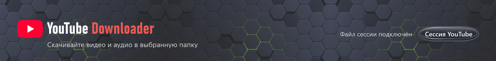
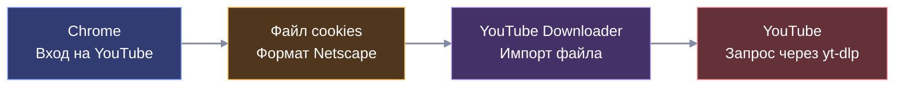

<h1 align="center">
  
</h1>

<div align="center">
  <p>Скачивайте видео с YouTube или сохраняйте только звук в MP3.</p>
  
  
  
  <p><a href="#установка-на-windows">Установка на Windows</a> · <a href="#как-пользоваться">Как пользоваться</a> · <a href="#сессия-youtube">Сессия YouTube</a> · <a href="#сборка-для-windows">Сборка для Windows</a> · <a href="#если-загрузка-не-удалась">Помощь с загрузкой</a></p>
</div>

## Установка на Windows

Для **Windows 10 и 11 (x64)** используйте готовый установщик **`YoutubeDownloader-Setup-x64.exe`**.

1. Перенесите `YoutubeDownloader-Setup-x64.exe` на новый ПК.
2. Запустите установщик и пройдите шаги мастера. При установке в папку по умолчанию права администратора не нужны.
3. Откройте **YouTube Downloader** через меню «Пуск».

В комплект уже входят .NET, yt-dlp, Deno и FFmpeg. Для установки интернет не нужен, он понадобится при проверке ссылки и скачивании видео.

Сборка установщика есть в локальной папке `publish` проекта. В GitHub Releases файл пока не выложен.

## Как пользоваться

1. Вставьте ссылку на ролик и нажмите **«Проверить»**. В карточке появятся название, обложка, канал и длительность, если они доступны.
2. Нажмите жёлтый значок папки и выберите, куда сохранить файл.
3. Нажмите **«Скачать видео»**, чтобы сохранить ролик, или **«Скачать MP3»**, чтобы получить звуковую дорожку.
4. Следите за ходом загрузки в журнале под кнопками. Активную операцию можно прервать кнопкой **«Отменить»**.

<p align="center">
  
</p>

## Сессия YouTube

Если YouTube просит войти, подключите в загрузчике сессию браузера, в котором открывается ролик. Она используется при проверке HTTPS-ссылок YouTube и скачивании видео или MP3.

> [!NOTE]
> Для этой функции используйте переносимый `publish/YoutubeDownloader.exe` версии **1.0.21** или [соберите приложение из исходников](#сборка-для-windows). Локальный установщик **1.0.16** выпущен до появления меню сессии.

### 🌐 Google Chrome через файл cookies

1. Откройте ролик на YouTube в Chrome и убедитесь, что вошли под нужным Google-аккаунтом.
2. Установите **Get cookies.txt LOCALLY** и откройте его на вкладке ролика. В поле **Export Format** выберите **Netscape** и нажмите **Export**, чтобы сохранить cookies текущего сайта. [Страница расширения в Chrome Web Store](https://chromewebstore.google.com/detail/get-cookiestxt-locally/cclelndahbckbenkjhflpdbgdldlbecc)
3. В загрузчике откройте **«Сессия YouTube» → «Выбрать файл cookies.txt…»** и укажите сохранённый файл. Chrome может назвать его `www.youtube.com_cookies.txt`.
4. Когда появится **«Файл сессии подключён»**, вставьте ссылку и нажмите **«Проверить»**. Если карточка показала сведения о ролике, можно нажать **«Скачать видео»** или **«Скачать MP3»**.

<p align="center">
  
</p>

### 🔗 Как используется файл



Загрузчик запоминает путь к выбранному файлу и автоматически восстанавливает этот выбор при следующем запуске. При проверке или скачивании он передаёт `yt-dlp` временную копию с записями только для домена YouTube. Копия удаляется после завершения или отмены операции.

Чтобы перестать использовать файл, нажмите **«Отключить сессию»**. Если файл перемещён, выберите его заново. Если YouTube завершил сессию, экспортируйте свежий файл. [Подробнее в документации yt-dlp](https://github.com/yt-dlp/yt-dlp/wiki/Extractors#exporting-youtube-cookies)

> [!IMPORTANT]
> Файл cookies даёт доступ к вашей сессии. Храните его локально. Не отправляйте его в чат и не добавляйте в репозиторий.

### 🦊 Подключение профиля браузера

В Firefox можно войти на YouTube и затем выбрать **«Сессия YouTube» → Firefox → ваш профиль**. Приложение запомнит этот выбор. В меню также доступны Chrome и Edge. При ошибке чтения cookies из Chrome или Edge выберите **«Выбрать файл cookies.txt…»**.

## Сборка для Windows

<details>
<summary>Команды сборки из исходников</summary>

Для сборки понадобятся Windows x64, Git и [.NET 8 SDK](https://dotnet.microsoft.com/download/dotnet/8.0). Откройте PowerShell, подключитесь к интернету и выполните команды.

```powershell
git clone https://github.com/Mikhail-068/YouTube_download.git
Set-Location YouTube_download

powershell -ExecutionPolicy Bypass -File .\scripts\Get-Dependencies.ps1
dotnet publish .\YoutubeDownloader.csproj -c Release -r win-x64 --self-contained true -p:PublishSingleFile=true -p:IncludeNativeLibrariesForSelfExtract=true -o .\publish

New-Item -ItemType Directory -Path .\publish\tools -Force | Out-Null
Copy-Item .\tools\*.exe -Destination .\publish\tools -Force
.\publish\YoutubeDownloader.exe
```

Приложение находится в `publish` и запускается с включённой в сборку .NET. При переносе на другой компьютер скопируйте вместе с EXE папку `tools` с файлами `yt-dlp.exe`, `deno.exe`, `ffmpeg.exe` и `ffprobe.exe`.

</details>

## Если загрузка не удалась

- Если ролик доступен в браузере, нажмите **«Обновить yt-dlp»**, дождитесь завершения и повторите попытку. Кнопка устанавливает свежую сборку из канала nightly.
- Если YouTube просит войти или сообщает, что сессию браузера прочитать не удалось, откройте раздел [«Сессия YouTube»](#сессия-youtube). Если ранее подключённый файл перестал работать, войдите на YouTube в браузере и экспортируйте свежий файл.
- Если приложение не находит утилиты, проверьте папку `tools` рядом с EXE. Команда скачивания утилит приведена в разделе сборки.
- Если ошибка повторяется, загляните в журнал внизу окна. В нём выводятся сообщения yt-dlp во время загрузки.

## Как устроено приложение

| Компонент | Что делает |
| --- | --- |
| WPF и .NET 8 | Показывают окно, карточку видео и журнал |
| [yt-dlp](https://github.com/yt-dlp/yt-dlp) | Получает сведения о ролике и скачивает медиа |
| [Deno](https://deno.com/) | Выполняет JavaScript, который требуется yt-dlp для обработки ссылок YouTube |
| [FFmpeg и FFprobe](https://ffmpeg.org/) | Обрабатывают медиапотоки, в том числе при сохранении звука в MP3 |

Подробности есть в [описании архитектуры](docs/architecture/README.md). Сборка установщика описана в [сценарии NSIS](installer/YoutubeDownloader.nsi).

## Условия использования и лицензия

YouTube Downloader — независимый проект. Название YouTube и логотип принадлежат их правообладателям. Условия использования этих обозначений описаны в [правилах бренда Google](https://about.google/brand-resource-center/guidance/).

Скачивайте материалы только при наличии необходимых прав и разрешений. Соблюдайте [условия использования YouTube](https://www.youtube.com/t/terms) и применимое законодательство.

Авторский исходный код распространяется по [лицензии MIT](LICENSE). Для сторонних материалов и утилит действуют условия их правообладателей. Сведения о комплектных утилитах приведены в [уведомлениях установщика](installer/dependency-notices.txt).

Автор проекта — [Mikhail-068](https://github.com/Mikhail-068).
