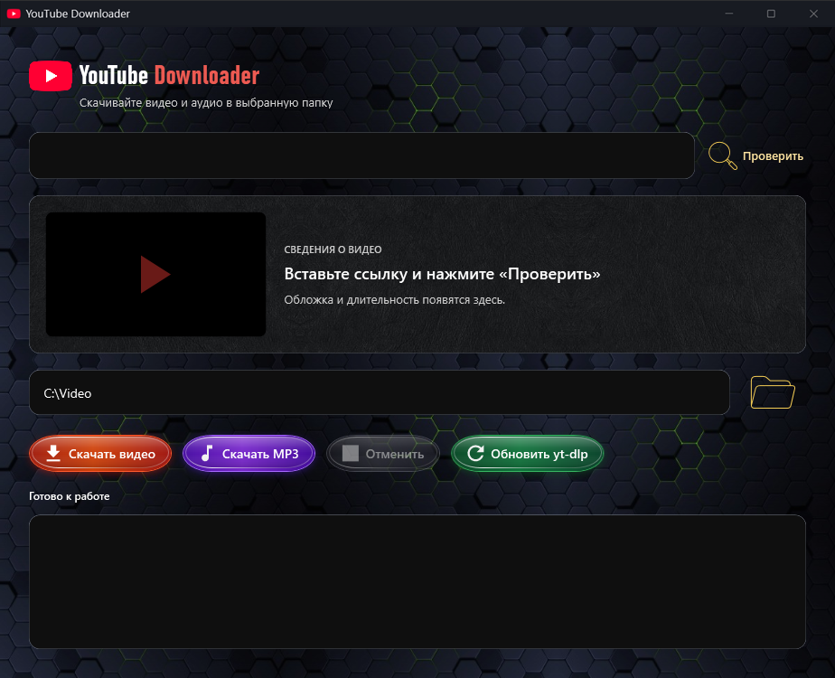

<div align="center">

# 🎬 YouTube Downloader

**Лёгкая WPF-оболочка над [`yt-dlp`](https://github.com/yt-dlp/yt-dlp) для Windows**

Скачивайте видео и аудио в выбранную папку — без рекламы, без аккаунтов, без сторонних .NET-обёрток.


</div>

---

## ✨ Возможности

- 🎥 **Скачивание видео** в лучшем качестве (`bv*+ba/b`)
- 🎵 **Извлечение аудио** в MP3 одним кликом
- 🖼️ **Предпросмотр** — обложка, название, канал, длительность до загрузки
- 📁 **Выбор папки** назначения через системный диалог
- 🔄 **Автообновление** yt-dlp до nightly-канала прямо из приложения
- 📝 **Живой лог** процесса в реальном времени
- ⏹️ **Отмена** загрузки в любой момент
- 🎨 **Тёмная тема** в фирменном стиле YouTube, с анимациями и иконками
- 🧩 **Современные YouTube-челленджи** — локальный Deno помогает yt-dlp получать форматы без cookies браузера
- 🔒 **Локальная работа** — yt-dlp, Deno и FFmpeg лежат в папке `tools`; аккаунт YouTube не используется

---

## 📸 Скриншот



---

## 🚀 Быстрый старт

### 1. Установите зависимости (yt-dlp + Deno + FFmpeg)

В PowerShell из папки проекта:

```powershell
powershell -ExecutionPolicy Bypass -File .\scripts\Get-Dependencies.ps1
```

Скрипт скачает в папку `tools`:
- `yt-dlp.exe`
- `deno.exe`
- `ffmpeg.exe`
- `ffprobe.exe`

### 2. Соберите приложение

```bash
dotnet publish -c Release -r win-x64 --self-contained false -o publish
```

### 3. Запустите

```bash
.\publish\YoutubeDownloader.exe
```

> 💡 Убедитесь, что каталог `tools` с бинарниками лежит рядом с `YoutubeDownloader.exe`.

---

## 🎯 Как пользоваться

1. Вставьте ссылку на видео или плейлист YouTube в верхнее поле.
2. Нажмите **«Проверить»** — появится обложка, название и длительность.
3. Выберите папку сохранения кнопкой **«Папка»**.
4. Нажмите:
   - **«Скачать видео»** — для видео в лучшем качестве
   - **«Скачать MP3»** — для извлечения аудио
5. Следите за прогрессом в журнале. Кнопка **«Отменить»** прервёт загрузку.

---

## 🛠️ Технологии

| Компонент | Назначение |
|-----------|-----------|
| [.NET 8](https://dotnet.microsoft.com/) + WPF | Графический интерфейс (XAML) |
| [yt-dlp](https://github.com/yt-dlp/yt-dlp) | Движок загрузки |
| [Deno](https://deno.com/) | Выполнение JavaScript-челленджей YouTube |
| [FFmpeg](https://ffmpeg.org/) | Конвертация и мультиплексирование |
| `ProcessStartInfo.ArgumentList` | Безопасная передача аргументов |

Приложение **не содержит** ключей API и **не использует** сторонние .NET-обёртки над yt-dlp — только прямой запуск процесса.

---

## 📁 Структура проекта

```
YoutubeDownloader/
├── App.xaml              # Стили, палитра, шаблоны (тёмная тема YouTube)
├── MainWindow.xaml       # Вёрстка интерфейса
├── MainWindow.xaml.cs    # Логика взаимодействия с yt-dlp
├── scripts/
│   └── Get-Dependencies.ps1   # Загрузка yt-dlp, Deno и FFmpeg
├── tools/                # Бинарники (yt-dlp.exe, deno.exe, ffmpeg.exe, ffprobe.exe)
└── YoutubeDownloader.csproj
```

---

## ⚖️ Использование и ответственность

Эта программа — лишь графическая оболочка над свободным инструментом `yt-dlp`.

- Скачивайте **только** те материалы, на которые у вас есть права (свободные лицензии, собственный контент, общественное достояние).
- Соблюдайте [Условия использования YouTube](https://www.youtube.com/t/terms) и авторское право вашей юрисдикции.
- Автор приложения не несёт ответственности за неправомерное использование.

---

## 🔄 Обновление yt-dlp

YouTube регулярно меняет внутренние форматы, из-за чего yt-dlp иногда перестаёт работать. В приложении есть кнопка **«Обновить yt-dlp»** — она переключается на **nightly-канал**, который yt-dlp рекомендует при поломках.

---

<div align="center">

**Сделано с ❤️ для личного использования**

</div>
